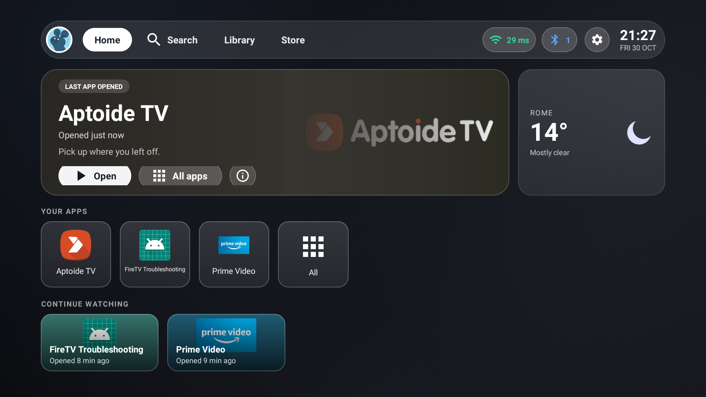
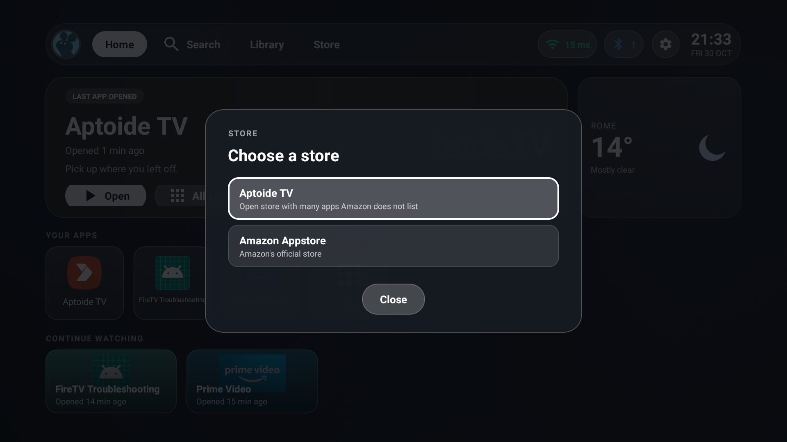
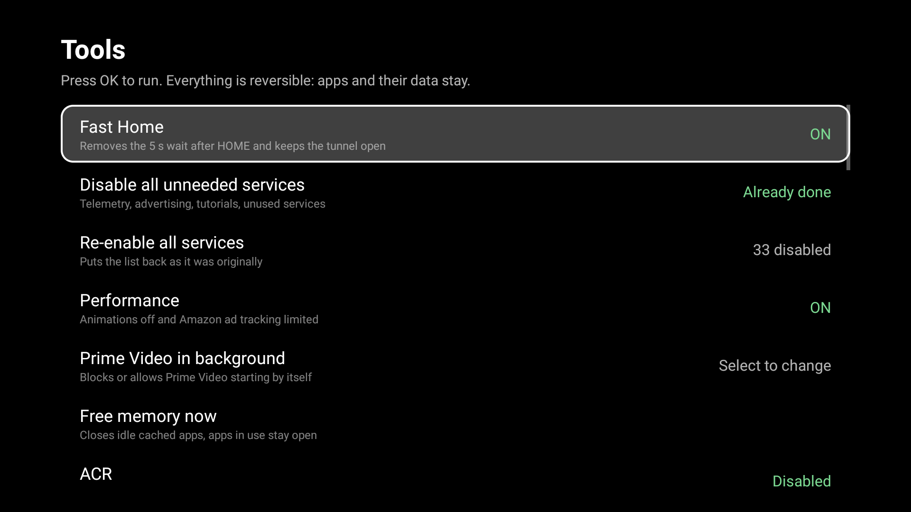

# CrackedNamless-FireOS

A fast, glass-style Home screen for Amazon Fire TV. It replaces the ad-heavy Amazon launcher with a clean one that opens in about a second on a 1 GB Fire TV Stick, and ships a set of tools to remove Amazon background services.

[](https://github.com/CrackedNamless/CrackedNamless-FireOS/releases/latest)
[](LICENSE)
-orange?style=flat-square)



## What you get

- **A clean Home.** Frosted-glass top bar, a card for the last app you opened, your apps, a "continue watching" row and a full library. No ads, no promoted content.
- **It really replaces Home.** Pressing the Home button on the remote shows this launcher, even though Fire OS pins Amazon's.
- **App stores built in.** The **Store** tab in the top bar lets you choose between [Aptoide TV](https://tv.aptoide.com), which the installer adds for you, and the Amazon Appstore that is already on the Fire TV. Skip Aptoide with `--no-store`.
- **Fast.** Fire OS normally delays app launches for 5 seconds after Home. Fast Home removes that wait, so Home appears in about 1.2 s.
- **Status at a glance.** Wi-Fi latency, Bluetooth, clock and weather ([Open-Meteo](https://open-meteo.com)).
- **A Tools menu** to switch off Amazon telemetry and background services in bulk, stop Prime Video from starting by itself, free memory and set a performance preset. Everything is reversible.
- **Light on memory.** Plain Android views, no heavy frameworks, no analytics, no resident helper process.





> The interface follows the Fire TV system language automatically: English and Italian are included, anything else shows English. To add a language, copy `app/src/main/res/values/strings.xml` to `values-xx/strings.xml` and translate it; pull requests are welcome.

## Compatibility

| Device | Status |
| --- | --- |
| Fire TV Stick Lite (Fire OS 7, Android 9) | Tested |
| Other Fire TV devices on Fire OS 5-7 | Should work, not tested |
| Fire OS 8 (Android 11) | Not tested, the Home takeover may behave differently |

## Install

You need a PC (or any device that can run `adb`) on the same network as the Fire TV. The Fire TV does not need to be rooted.

### Install it with Claude Code

The easy way. [Claude Code](https://claude.com/claude-code) does the setup, and you press OK on the remote when the TV asks.

**1. Turn on developer mode on the Fire TV.** Settings > My Fire TV > About. Highlight the device name and press OK 7 times. Go back, open Developer Options and turn on **ADB debugging**. Your Fire TV's IP address is under Settings > My Fire TV > About > Network.

**2. Open Claude Code on a computer on the same Wi-Fi.** Then paste this:

```text
Install CrackedNamless-FireOS on my Fire TV: https://github.com/CrackedNamless/CrackedNamless-FireOS
My Fire TV's IP address is <ip address>. It's a <model, from Settings > My Fire TV > About>.

1. Clone the repo. Read README.md and tools/install.sh before running anything.
2. Install what's missing (adb, and git if needed). The app is downloaded as a signed APK, nothing has to be built.
3. Run tools/install.sh <ip>. Tell me when to accept the debugging prompt on the TV ("Always allow").
4. Check that the Home accessibility service is enabled, then check that pressing Home opens
   CrackedNamless-FireOS, and tell me what you see.
5. Explain in plain words what the Tools menu does (long-press OK on the settings icon) and what Fast Home
   needs from me on the TV. Ask me before turning anything off or on.
6. Tell me how to undo everything.
```

Claude Code reads the script first, so you can see what it is about to do. It installs this app and the Aptoide TV store (add `--no-store` to the command if you do not want the store). `tools/undo.sh` removes our app; the store is removed with `adb uninstall cm.aptoidetv.pt`.

### Install by hand

#### 1. Prepare the Fire TV

1. Go to **Settings > My Fire TV > About**, highlight the device name and press **OK seven times**. Developer options are now unlocked.
2. Go to **Settings > My Fire TV > Developer options** and turn on **ADB debugging**. If you plan to use the Downloader app, also allow installs from unknown sources there.
3. Note the IP address from **Settings > My Fire TV > About > Network**.

#### 2. Get the app

Pick one.

**A. One command (macOS, Linux, Windows with Git Bash or WSL)**

Install [Android Platform Tools](https://developer.android.com/tools/releases/platform-tools) so that `adb` is on your path, then:

```bash
git clone https://github.com/CrackedNamless/CrackedNamless-FireOS.git
cd CrackedNamless-FireOS
tools/install.sh 192.168.1.50      # use your Fire TV's IP
```

The script downloads the latest release, installs it, grants the two permissions it needs and turns the Home service on. It then installs [Aptoide TV](https://tv.aptoide.com) for the Store tab: it fetches the current build from Aptoide's API and refuses to install it if the MD5 does not match the one Aptoide publishes. Add `--no-store` to skip this step. When the TV shows **Allow USB debugging?**, choose **Always allow**.

**B. By hand (any OS, plain `adb`)**

Download `CrackedNamless-FireOS.apk` from the [latest release](https://github.com/CrackedNamless/CrackedNamless-FireOS/releases/latest), then:

```bash
adb connect 192.168.1.50:5555
adb install -r CrackedNamless-FireOS.apk
adb shell pm grant com.crackednamless.fireos android.permission.READ_LOGS
adb shell cmd notification allow_listener com.crackednamless.fireos/com.crackednamless.fireos.MediaListener
adb shell settings put secure enabled_accessibility_services com.crackednamless.fireos/com.crackednamless.fireos.HomeService
adb shell settings put secure accessibility_enabled 1
adb shell am start -n com.crackednamless.fireos/.HomeActivity
```

If you already use another accessibility service, append ours to the list with a colon instead of replacing it. Check the current value with `adb shell settings get secure enabled_accessibility_services`.

> You can also sideload the APK from the TV with the [Downloader](https://www.aftvnews.com/downloader/) app, using this link:
> `https://github.com/CrackedNamless/CrackedNamless-FireOS/releases/latest/download/CrackedNamless-FireOS.apk`
> The permissions and the Home service still have to be set with the `adb` commands above, because Fire OS does not let an app grant them to itself.

#### 3. Use it

Press **Home** on the remote. The first time can take a few seconds while the service starts.

## Using it

| Action | How |
| --- | --- |
| Open an app | Select its tile and press OK |
| App info | **i** button on the hero card |
| All apps | **All apps**, or the Library tab |
| Get new apps | **Store** tab, then choose Aptoide TV or the Amazon Appstore |
| Tools menu | Long-press OK on the settings icon in the top bar |
| Amazon settings | Short press OK on the settings icon |

### Fast Home

The first row of the Tools menu turns on Fast Home. Android blocks background app launches for 5 seconds after Home is pressed; Fast Home lifts that block as soon as you press Home. To work, the app opens a local ADB session to the Stick itself:

1. Select **Fast Home** and press OK.
2. Accept the **VPN connection request**. The VPN is local only: it uses the private range `10.113.77.0/24` and no traffic leaves the device.
3. Accept **Allow USB debugging?** with **Always allow**.

Switch the row off at any time to close the session and the tunnel.

### Tools menu

| Row | What it does |
| --- | --- |
| Disable all unneeded services | Disables 33 Amazon telemetry, advertising, tutorial and unused services in one go |
| Re-enable all services | Puts every one of them back |
| Performance | Window and transition animations off, Amazon ad tracking limited |
| Prime Video in background | Blocks or allows Prime Video starting by itself at boot |
| Free memory now | Closes cached background apps and shows the memory freed |
| Service list | One toggle per service |

Services are turned off with `pm disable-user`: the APK and its data stay on the device, and a single tap brings them back. System updates can re-enable some of them. Open the Tools menu and run the bulk action again.

## How it works

- **Home takeover.** Fire OS pins Amazon's launcher as Home and ignores third-party launchers. The app runs an accessibility service that notices the Home press, instantly covers the screen with an overlay and then brings its own Home forward.
- **The 5-second wait.** After Home, Android stops app switches for 5 seconds, and the overlay hides that wait. With Fast Home on, the app calls `ActivityManager.resumeAppSwitches` through a shell session.
- **Shell access from the app.** Fire OS closes any ADB connection that the device opens to itself. The app works around it with a local `VpnService` that rewrites addresses so `adbd` sees an outside peer, then speaks the ADB protocol itself (RSA key in app storage). The technique comes from [Sarg338/Homestead](https://github.com/Sarg338/Homestead); this code is written from scratch.

## Update

Download the new APK from the [releases page](https://github.com/CrackedNamless/CrackedNamless-FireOS/releases) and run:

```bash
adb install -r CrackedNamless-FireOS.apk
```

Releases are signed with the same key, so updates install over the old version and keep your settings. Run `adb shell settings get secure enabled_accessibility_services` afterwards: if our service is missing, run `tools/install.sh` again.

## Undo

```bash
tools/undo.sh 192.168.1.50                # give Home back to Amazon, keep the app
tools/undo.sh 192.168.1.50 --uninstall    # and remove the app
```

Without the script: `adb uninstall com.crackednamless.fireos`. If you turned services off from the Tools menu, use **Re-enable all services** first.

## Build from source

You need JDK 17 and the Android SDK (platform 34).

```bash
git clone https://github.com/CrackedNamless/CrackedNamless-FireOS.git
cd CrackedNamless-FireOS
echo "sdk.dir=/path/to/android-sdk" > local.properties
./gradlew assembleDebug testDebugUnitTest
```

The APK is in `app/build/outputs/apk/debug/`. For a signed release build, create `keystore.properties` next to `build.gradle` with `storeFile`, `storePassword`, `keyAlias` and `keyPassword`, then run `./gradlew assembleRelease`. The file is git-ignored.

## Security and privacy

- The app holds an ADB key that you authorised with **Always allow**. That gives it shell-level access on this Fire TV, which is how the Tools menu works. Turn **ADB debugging** off in Developer options to cut that access, or uninstall the app, which deletes the key.
- `READ_LOGS` is used to detect the Home and power buttons from the system log. Logs are not stored or sent anywhere.
- The launcher's only network request is the weather lookup to Open-Meteo. There is no analytics, no tracking and no account.
- Aptoide TV is a third-party store made by Aptoide, not by this project. It is installed only by `tools/install.sh` (never by the app itself), and apps you download from it are your responsibility. Use `--no-store` if you prefer not to have it.
- The weather location defaults to Rome. Change `weather_default_city` in `strings.xml` and `DEFAULT_LAT` and `DEFAULT_LON` in `Weather.java`.

## Troubleshooting

**Home still opens Amazon's launcher.** The accessibility service is off. Run `adb shell settings get secure enabled_accessibility_services`; if our service is not listed, repeat the last two `settings` commands of the manual install.

**Fast Home says another VPN is active.** Only one VPN can run at a time. Turn the other one off, then try again.

**The VPN or ADB prompt does not appear.** Make sure **ADB debugging** is on, then toggle Fast Home off and on again.

**The Store chooser says Aptoide TV is not installed.** Run `tools/install.sh <ip>` again (without `--no-store`); it only adds what is missing.

**I want Amazon's launcher back right now.** Run `tools/undo.sh <ip>`.

## Credits

- The loopback-VPN idea for talking to the device's own `adbd` comes from [Sarg338/Homestead](https://github.com/Sarg338/Homestead) (GPL-3.0). No code was copied.
- Weather data by [Open-Meteo](https://open-meteo.com).

This project is not affiliated with or endorsed by Amazon. Fire TV and Alexa are trademarks of Amazon.com, Inc.

## License

[MIT](LICENSE)
